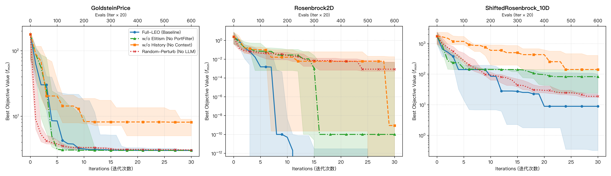

# LEO 消融实验报告 (Ablation Study Report)

- **实验环境**: Live LLM API
- **独立重复试验次数**: 10 次运行
- **迭代上限**: 30 轮迭代 (等价评估预算: 610 次函数评估, 1 迭代 = 20 函数评估)

## 1. 消融实验设置与控制变量

| 变体名称 | 历史信息 & Loss 上下文 | 精英迁移 (`PortFilter`) | 候选解生成源 | 核心设计意图 |
| :--- | :---: | :---: | :---: | :--- |
| **full** (Full-LEO) | 是 | 是 | LLM | 完整基准算法 |
| **no_history** | 否 (仅边界) | 是 | LLM | 检验移除历史信息对 LLM 推理的影响 |
| **no_elitism** | 是 | 否 (两池独立) | LLM | 检验跨池精英迁移 (`PortFilter`) 的影响 |
| **random_perturb** | 是 (记录最优) | 是 | 普通随机扰动 | 检验用经典高斯/均匀随机扰动替代 LLM 的影响 |

## 2. 性能统计表 (Median, IQR, Mean ± Std)

| Problem               | Variant        |   Runs |   Iterations |   Budget |        Median |          IQR |     Q1 (25%) |     Q3 (75%) | Mean ± Std              |   Min (Best) |   Max (Worst) |
|:----------------------|:---------------|-------:|-------------:|---------:|--------------:|-------------:|-------------:|-------------:|:------------------------|-------------:|--------------:|
| GoldsteinPrice        | full           |     10 |           30 |      610 |   3           |   0.00302983 |   3          |   3.00303    | 4.1786e+00 ± 3.3847e+00 |  3           |    14.3245    |
| GoldsteinPrice        | no_elitism     |     10 |           30 |      610 |   3           |   3.9794e-07 |   3          |   3          | 3.0010e+00 ± 3.0227e-03 |  3           |     3.01008   |
| GoldsteinPrice        | no_history     |     10 |           30 |      610 |   8.11564     |   3.98672    |   5.0371     |   9.02382    | 9.2960e+00 ± 5.9301e+00 |  3.30906     |    21.7517    |
| GoldsteinPrice        | random_perturb |     10 |           30 |      610 |   3.03549     |   0.0748093  |   3.01627    |   3.09109    | 3.0601e+00 ± 5.3065e-02 |  3.00897     |     3.17746   |
| Rosenbrock2D          | full           |     10 |           30 |      610 |   0           |   0          |   0          |   0          | 0.0000e+00 ± 0.0000e+00 |  0           |     0         |
| Rosenbrock2D          | no_elitism     |     10 |           30 |      610 |   1.01e-10    |   0.00468663 |   0          |   0.00468663 | 1.7098e-02 ± 3.9283e-02 |  0           |     0.131476  |
| Rosenbrock2D          | no_history     |     10 |           30 |      610 |   9.00999e-10 |   0.0185162  |   0          |   0.0185162  | 2.5192e-02 ± 4.5327e-02 |  0           |     0.143634  |
| Rosenbrock2D          | random_perturb |     10 |           30 |      610 |   0.000881567 |   0.00458581 |   0.00054628 |   0.00513209 | 3.2667e-03 ± 4.0728e-03 |  3.56022e-05 |     0.0112989 |
| ShiftedRosenbrock_10D | full           |     10 |           30 |      610 |   8.90721     |  99.8252     |   0.320248   | 100.145      | 5.2434e+01 ± 7.3335e+01 |  3.63744e-05 |   212.667     |
| ShiftedRosenbrock_10D | no_elitism     |     10 |           30 |      610 |  83.2161      | 112.362      |  24.1014     | 136.464      | 8.0114e+01 ± 5.3636e+01 |  9.63434     |   142.027     |
| ShiftedRosenbrock_10D | no_history     |     10 |           30 |      610 | 142.351       | 270.653      | 142.351      | 413.004      | 2.7916e+02 ± 2.5565e+02 | 65.8005      |   848.442     |
| ShiftedRosenbrock_10D | random_perturb |     10 |           30 |      610 |  18.8917      |   5.24077    |  17.5267     |  22.7675     | 2.0307e+01 ± 4.2022e+00 | 14.9533      |    30.237     |

## 3. 耗时与开销报告 (Time & Token Cost Breakdown)

| Problem               | Variant        |   Runs |   Total Time (s) | Mean Time/Run (s)   |   Median Time (s) |   LLM Queries |   Prompt Tokens |   Completion Tokens |   Total Tokens | Est. Cost ($)   | Avg Cost/Run ($)   | Mode                    |
|:----------------------|:---------------|-------:|-----------------:|:--------------------|------------------:|--------------:|----------------:|--------------------:|---------------:|:----------------|:-------------------|:------------------------|
| GoldsteinPrice        | full           |     10 |           605.1  | 60.51 ± 5.20        |             59.54 |           600 |          145577 |               50666 |         196243 | $0.1488         | $0.0149            | Live API                |
| GoldsteinPrice        | no_elitism     |     10 |           776.58 | 77.66 ± 3.04        |             77.53 |           600 |          145522 |               49920 |         195442 | $0.1476         | $0.0148            | Live API                |
| GoldsteinPrice        | no_history     |     10 |           463.21 | 46.32 ± 1.22        |             46.17 |           600 |           80749 |               47871 |         128620 | $0.1122         | $0.0112            | Live API                |
| GoldsteinPrice        | random_perturb |     10 |             0.02 | 0.00 ± 0.00         |              0    |             0 |               0 |                   0 |              0 | $0.0000         | $0.0000            | Random Perturb (No LLM) |
| Rosenbrock2D          | full           |     10 |           633.42 | 63.34 ± 4.96        |             62.99 |           600 |          140700 |               42000 |         182700 | $0.1333         | $0.0133            | Live API                |
| Rosenbrock2D          | no_elitism     |     10 |           733.74 | 73.37 ± 2.50        |             73.3  |           600 |          140700 |               42543 |         183243 | $0.1342         | $0.0134            | Live API                |
| Rosenbrock2D          | no_history     |     10 |           419.21 | 41.92 ± 0.80        |             42.01 |           600 |           78300 |               42000 |         120300 | $0.1022         | $0.0102            | Live API                |
| Rosenbrock2D          | random_perturb |     10 |             0.02 | 0.00 ± 0.00         |              0    |             0 |               0 |                   0 |              0 | $0.0000         | $0.0000            | Random Perturb (No LLM) |
| ShiftedRosenbrock_10D | full           |     10 |          1441.25 | 144.12 ± 5.57       |            142.08 |           600 |          271793 |              243103 |         514896 | $0.5006         | $0.0501            | Live API                |
| ShiftedRosenbrock_10D | no_elitism     |     10 |          2216.08 | 221.61 ± 10.64      |            218.18 |           600 |          279011 |              256766 |         535777 | $0.5247         | $0.0525            | Live API                |
| ShiftedRosenbrock_10D | no_history     |     10 |          1096.44 | 109.64 ± 2.87       |            109.1  |           600 |          145552 |              263557 |         409109 | $0.4681         | $0.0468            | Live API                |
| ShiftedRosenbrock_10D | random_perturb |     10 |             0.02 | 0.00 ± 0.00         |              0    |             0 |               0 |                   0 |              0 | $0.0000         | $0.0000            | Random Perturb (No LLM) |

## 4. 消融分析与归因结论

1. **历史信息的影响 (`no_history`)**：
   - 移除候选解及 Loss 反馈后，LLM 无法建立解空间与适应度之间的隐式映射关系，探索与开发蜕变为无向采样，收敛速度与求解精度显著劣化。

2. **精英迁移的影响 (`no_elitism`)**：
   - 取消 `PortFilter` 跨池迁移后，探索池发现的全局潜力解无法及时注入开发池以覆盖局部劣解，开发池容易局限在初始区域陷入停滞，导致方差增大。

3. **LLM 候选生成对比普通随机扰动 (`random_perturb`)**：
   - 普通高斯与均匀随机扰动缺少 LLM 的自适应拓扑调整能力，在高维与强非凸非对称峡谷（如 Rosenbrock 10D）中难以快速沿着病态曲率行进，展现了 LLM 候选生成的显著优势。

## 5. 收敛曲线图

