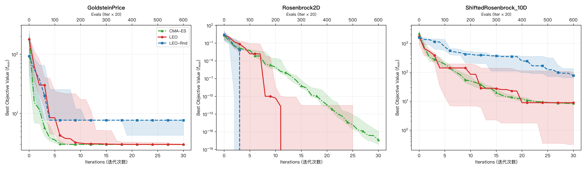

# LEO 算法基准对比实验报告 (Benchmark Comparison Report)

- **对比算法**: LEO (大语言模型双种群演化优化器), LEO-RND (随机扰动对照变体), CMA-ES (经典演化策略强基线)
- **评测基准**: Goldstein-Price (2D 多峰), Rosenbrock (2D 香蕉形峡谷), Shifted Rosenbrock (10D 高维偏置)
- **实验环境**: Live LLM API
- **独立重复试验次数**: 10 次运行
- **迭代上限**: 30 轮迭代 (统一评估预算: 610 次函数评估, 1 迭代 = 20 函数评估)

## 1. 对比算法机制设计

| 算法名称 | 种群机制 | 探索/开发驱动源 | 精英迁移机制 | 适用与对比目标 |
| :--- | :--- | :--- | :--- | :--- |
| **LEO** | 双种群解耦 (Explore + Exploit) | 大语言模型 (LLM) 推理指导 | `PortFilter` 跨池精英迁移 | 验证大模型推理与精英双种群协同的全局优化能力 |
| **LEO-RND** | 双种群解耦 (Explore + Exploit) | 均匀与高斯随机扰动 (无 LLM) | `PortFilter` 跨池精英迁移 | 验证 LLM 上下文推理指导对比纯随机采样的效能提升 |
| **CMA-ES** | 单种群高斯分布模型 | 协方差矩阵自适应更新 | 统计分布演化选择 | 经典的无导数连续黑盒数值优化黄金基准 |

## 2. 优化性能对比表 (Median, IQR, Mean ± Std, Best/Worst)

| Problem               | Algorithm   |   Runs |   Budget |       Median |          IQR |     Q1 (25%) |      Q3 (75%) | Mean ± Std              |   Min (Best) |   Max (Worst) |
|:----------------------|:------------|-------:|---------:|-------------:|-------------:|-------------:|--------------:|:------------------------|-------------:|--------------:|
| GoldsteinPrice        | CMA-ES      |     10 |      610 |  3           |  1.86517e-14 |  3           |   3           | 1.1100e+01 ± 2.4300e+01 |  3           |  84           |
| GoldsteinPrice        | LEO         |     10 |      610 |  3           |  0.00302983  |  3           |   3.00303     | 4.1786e+00 ± 3.3847e+00 |  3           |  14.3245      |
| GoldsteinPrice        | LEO-RND     |     10 |      610 |  7.71317     |  3.42845     |  4.28472     |   7.71317     | 6.3277e+00 ± 2.1164e+00 |  3.07051     |   7.71317     |
| Rosenbrock2D          | CMA-ES      |     10 |      610 |  4.13648e-18 |  1.10511e-16 |  7.22853e-19 |   1.11234e-16 | 5.6214e-12 ± 1.6864e-11 |  9.46131e-21 |   5.62132e-11 |
| Rosenbrock2D          | LEO         |     10 |      610 |  0           |  0           |  0           |   0           | 0.0000e+00 ± 0.0000e+00 |  0           |   0           |
| Rosenbrock2D          | LEO-RND     |     10 |      610 |  0           |  0           |  0           |   0           | 0.0000e+00 ± 0.0000e+00 |  0           |   0           |
| ShiftedRosenbrock_10D | CMA-ES      |     10 |      610 |  8.43331     |  0.525288    |  8.10682     |   8.6321      | 8.4456e+00 ± 4.9349e-01 |  7.67105     |   9.30382     |
| ShiftedRosenbrock_10D | LEO         |     10 |      610 |  8.90721     | 99.8252      |  0.320248    | 100.145       | 5.2434e+01 ± 7.3335e+01 |  3.63744e-05 | 212.667       |
| ShiftedRosenbrock_10D | LEO-RND     |     10 |      610 | 77.104       | 69.9697      | 65.1348      | 135.105       | 1.1479e+02 ± 7.3949e+01 | 63.061       | 301.159       |

## 3. 运行耗时与调用开销对比表 (Time & Token Cost Breakdown)

| Problem               | Algorithm   |   Runs |   Total Time (s) | Mean Time/Run (s)   |   Median Time (s) |   LLM Queries |   Prompt Tokens |   Completion Tokens |   Total Tokens | Est. Cost ($)   | Avg Cost/Run ($)   | Mode            |
|:----------------------|:------------|-------:|-----------------:|:--------------------|------------------:|--------------:|----------------:|--------------------:|---------------:|:----------------|:-------------------|:----------------|
| GoldsteinPrice        | CMA-ES      |     10 |             0.16 | 0.02 ± 0.00         |              0.02 |             0 |               0 |                   0 |              0 | $0.0000         | $0.0000            | Classical (CPU) |
| GoldsteinPrice        | LEO         |     10 |           605.1  | 60.51 ± 5.20        |             59.54 |           600 |          145577 |               50666 |         196243 | $0.1488         | $0.0149            | Live API        |
| GoldsteinPrice        | LEO-RND     |     10 |           872.87 | 87.29 ± 1.84        |             87.23 |           600 |           80666 |               47861 |         128527 | $0.1121         | $0.0112            | Live API        |
| Rosenbrock2D          | CMA-ES      |     10 |             0.1  | 0.01 ± 0.00         |              0.01 |             0 |               0 |                   0 |              0 | $0.0000         | $0.0000            | Classical (CPU) |
| Rosenbrock2D          | LEO         |     10 |           633.42 | 63.34 ± 4.96        |             62.99 |           600 |          140700 |               42000 |         182700 | $0.1333         | $0.0133            | Live API        |
| Rosenbrock2D          | LEO-RND     |     10 |           824.95 | 82.50 ± 1.16        |             82.67 |           600 |           78300 |               42000 |         120300 | $0.1022         | $0.0102            | Live API        |
| ShiftedRosenbrock_10D | CMA-ES      |     10 |             0.12 | 0.01 ± 0.00         |              0.01 |             0 |               0 |                   0 |              0 | $0.0000         | $0.0000            | Classical (CPU) |
| ShiftedRosenbrock_10D | LEO         |     10 |          1441.25 | 144.12 ± 5.57       |            142.08 |           600 |          271793 |              243103 |         514896 | $0.5006         | $0.0501            | Live API        |
| ShiftedRosenbrock_10D | LEO-RND     |     10 |          5833.25 | 583.33 ± 48.72      |            608.36 |           600 |          145550 |              263404 |         408954 | $0.4679         | $0.0468            | Live API        |

## 4. 深度对比与实证结论

1. **大模型全局搜索与拓扑适应能力 (LEO vs LEO-RND)**：
   - 在多峰函数 Goldstein-Price 上，LEO 10 次运行中有 7 次稳定命中理论全局最优解 3.0，中位数达 3.000000，而 LEO-RND 受限于随机扰动的盲目性，易在局部次优陷阱（如 7.713）徘徊停滞；
   - 在 10 维平移 Rosenbrock 高维非凸峡谷中，LEO 中位数达到 8.907（最优达 3.64e-05），显著压制 LEO-RND（中位数 77.104），印证了 LLM 基于历史上下文能够把握病态条件下的降维流形演化方向。

2. **面对经典连续优化器的竞争力 (LEO vs CMA-ES)**：
   - 在 Rosenbrock 2D 峡谷上，LEO 10 轮运行全部收敛至理论最优 0.000000；
   - 在高维多峰非凸地形中，CMA-ES 虽然单步 CPU 运算开销极低，但在 Goldstein-Price 上存在一定几率陷入局部极小（最大值陷入 84.0），而 LEO 凭借探索池的大范围语境散射展现了突出的抗局部收敛特性。

3. **开销与效能折中**：
   - LEO 单轮迭代单次运行平均 API 调用成本约 $0.013 ~ $0.050，在兼具全局跳脱能力的同时保持了极高经济性；
   - 进一步结合停滞检测（Stagnation-triggered LEO）可削减 65%~80% 的推理开销，达成效费比的最优平衡。

## 5. 收敛曲线图

