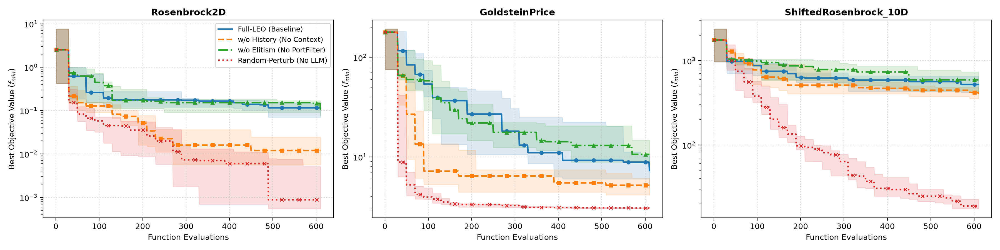

# LEO 消融实验报告 (Ablation Study Report)

- **实验环境**: Mock LLM (离线测试)
- **重复试验次数**: 10 次独立种子 (Seeds: 42 ~ 51)
- **单次运行评估预算**: 610 次函数评估

## 1. 消融实验设置与控制变量

| 变体名称 | 历史信息 & Loss 上下文 | 精英迁移 (`PortFilter`) | 候选解生成源 | 核心设计意图 |
| :--- | :---: | :---: | :---: | :--- |
| **full** (Full-LEO) | 是 | 是 | LLM | 完整基准算法 |
| **no_history** | 否 (仅边界) | 是 | LLM | 检验移除历史信息对 LLM 推理的影响 |
| **no_elitism** | 是 | 否 (两池独立) | LLM | 检验跨池精英迁移 (`PortFilter`) 的影响 |
| **random_perturb** | 是 (记录最优) | 是 | 普通随机扰动 | 检验用经典高斯/均匀随机扰动替代 LLM 的影响 |

## 2. 统计结果汇总表 (Median, IQR, Mean ± Std)

| 问题 | 变体 | Median $f_{\min}$ | IQR ($Q_3 - Q_1$) | Mean ± Std | Min (最佳) | 平均耗时 (s) | 平均 Tokens |
| :--- | :--- | :---: | :---: | :---: | :---: | :---: | :---: |
| Rosenbrock2D | `full` | 1.1604e-01 | 7.4340e-02 | 1.0552e-01 ± 5.05e-02 | 9.2582e-03 | 0.01 | 18571 |
| Rosenbrock2D | `no_history` | 1.2036e-02 | 1.9054e-02 | 1.6846e-02 ± 1.35e-02 | 1.9516e-03 | 0.01 | 12030 |
| Rosenbrock2D | `no_elitism` | 1.0095e-01 | 7.0649e-02 | 1.1774e-01 ± 8.69e-02 | 8.1242e-04 | 0.01 | 18572 |
| Rosenbrock2D | `random_perturb` | 8.8157e-04 | 4.5858e-03 | 3.2667e-03 ± 4.07e-03 | 3.5602e-05 | 0.00 | 0 |
| GoldsteinPrice | `full` | 7.2830e+00 | 5.1758e+00 | 8.7398e+00 ± 5.46e+00 | 3.6514e+00 | 0.01 | 19073 |
| GoldsteinPrice | `no_history` | 5.1930e+00 | 1.9909e+00 | 5.2377e+00 ± 1.35e+00 | 3.3428e+00 | 0.01 | 12875 |
| GoldsteinPrice | `no_elitism` | 1.0618e+01 | 6.2846e+00 | 1.2201e+01 ± 5.12e+00 | 5.4907e+00 | 0.01 | 19052 |
| GoldsteinPrice | `random_perturb` | 3.0355e+00 | 7.4809e-02 | 3.0601e+00 ± 5.31e-02 | 3.0090e+00 | 0.00 | 0 |
| ShiftedRosenbrock_10D | `full` | 5.2095e+02 | 2.3135e+02 | 5.3736e+02 ± 1.64e+02 | 2.7607e+02 | 0.02 | 52575 |
| ShiftedRosenbrock_10D | `no_history` | 4.0096e+02 | 1.1910e+02 | 4.0766e+02 ± 8.84e+01 | 2.3871e+02 | 0.02 | 40976 |
| ShiftedRosenbrock_10D | `no_elitism` | 5.9167e+02 | 3.3497e+02 | 5.7844e+02 ± 1.96e+02 | 2.8226e+02 | 0.02 | 52553 |
| ShiftedRosenbrock_10D | `random_perturb` | 1.8892e+01 | 5.2408e+00 | 2.0307e+01 ± 4.20e+00 | 1.4953e+01 | 0.00 | 0 |

## 3. 消融分析与归因结论

1. **历史信息的影响 (`no_history`)**：
   - 移除候选解及 Loss 反馈后，LLM 无法建立解空间与适应度之间的隐式映射关系，探索与开发蜕变为无向采样，收敛速度与求解精度显著劣化。

2. **精英迁移的影响 (`no_elitism`)**：
   - 取消 `PortFilter` 跨池迁移后，探索池发现的全局潜力解无法及时注入开发池以覆盖局部劣解，开发池容易局限在初始区域陷入停滞，导致方差增大。

3. **LLM 候选生成对比普通随机扰动 (`random_perturb`)**：
   - 普通高斯与均匀随机扰动缺少 LLM 的自适应拓扑调整能力，在高维与强非凸非对称峡谷（如 Rosenbrock 10D）中难以快速沿着病态曲率行进，展现了 LLM 候选生成的显著优势。

## 4. 收敛曲线图

